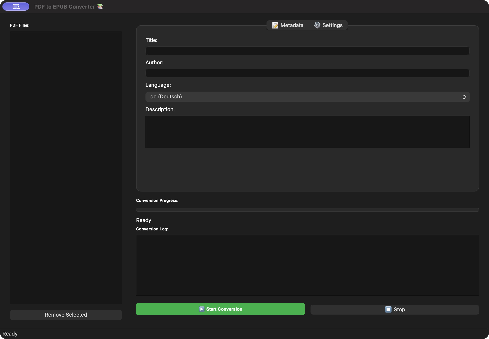

# PDF → EPUB Konverter

<p align="center"></p>

Eine lokale Desktop-Anwendung: PDFs auswählen, Metadaten bearbeiten und als EPUB speichern. Digitale Dokumente und gescannte Seiten werden unterstützt.

[Projektseite ansehen](https://michkffm.github.io/PDF-zu-Epub-Konverter/)

**Python · PyQt6 · pdfplumber · Tesseract · ebooklib · Pillow**



## Funktionen

- Mehrere PDFs nacheinander konvertieren, mit Fortschritt und abbrechbarer Warteschlange.
- Titel, Autor, Sprache und Beschreibung pro Datei bearbeiten.
- Ausgabeordner auswählen; vorhandene Bücher bleiben erhalten, neue Dateien bekommen bei Bedarf einen nummerierten Namen.
- OCR deaktivieren, für textlose Seiten automatisch einschalten oder für alle Seiten erzwingen.
- Bilder extrahieren, optional komprimieren und in einem eigenen Illustrationskapitel anzeigen.
- EPUB-Struktur vor der Veröffentlichung der Ausgabedatei prüfen.

PDFs haben feste Seitenlayouts. Das Ergebnis ist ein neu fließendes E-Book, keine originalgetreue Kopie. Tabellen, Spalten, Formeln und die genaue Position von Bildern können abweichen. Kapitel werden nach Textlänge aufgeteilt; eine semantische Kapitelerkennung ist nicht implementiert. Der integrierte Strukturprüfer ersetzt keine vollständige EPUBCheck-Prüfung.

## Installation

Voraussetzungen: **Python 3.11 oder neuer** und [Poetry](https://python-poetry.org/docs/#installation). Getestet wird lokal mit Python 3.14 auf macOS. Windows und Linux sind durch den verwendeten Stack grundsätzlich möglich, aber noch nicht manuell abgenommen.

```bash
git clone https://github.com/michkffm/PDF-zu-Epub-Konverter.git
cd PDF-zu-Epub-Konverter
poetry install
poetry run python src/main.py
```

Unter macOS/Linux sind alternativ `./setup.sh` und `./run_gui.sh` nutzbar. Das Setup installiert die Python-Pakete aus der Lockdatei; es installiert keine Systemsoftware und führt keine heruntergeladenen Installationsskripte aus.

### OCR einrichten

Für reine Text-PDFs ist Tesseract nicht erforderlich. Für Scans installiere [Tesseract samt Sprachdaten](https://tesseract-ocr.github.io/tessdoc/Installation.html). Die Anwendung benötigt kein separates Poppler oder pdf2image: Die Rasterisierung nutzt den bereits von pdfplumber mitgelieferten Renderer.

```bash
# macOS mit vorhandenem Homebrew, einschließlich deutscher Sprachdaten:
brew install tesseract tesseract-lang

# Debian/Ubuntu:
sudo apt install tesseract-ocr tesseract-ocr-deu tesseract-ocr-eng

# Verfügbare Sprachen prüfen:
tesseract --list-langs
```

Unter Windows Tesseract nach der verlinkten Anleitung installieren und sein Verzeichnis zum `PATH` hinzufügen. `de` in der Oberfläche benötigt `deu`, `en` benötigt `eng`. Fehlende Sprachdaten werden mit einer konkreten Fehlermeldung angezeigt.

## Bedienung

1. Über **File → Open PDF(s)** Dateien hinzufügen.
2. Je Datei die Metadaten prüfen; beim Wechsel bleiben Eingaben erhalten.
3. In **Settings** OCR, OCR-Sprache, Bildoptimierung und Validierung einstellen.
4. **Start Conversion** wählen und den Ausgabeordner festlegen.
5. Fortschritt im Fenster verfolgen und das fertige Buch im eigenen EPUB-Reader prüfen.

**Stop** leert die verbleibende Warteschlange und fordert den laufenden Auftrag zum Abbruch auf. Die Oberfläche bleibt bedienbar. Ein bereits laufender Tesseract-Aufruf endet spätestens nach seinem 60-Sekunden-Limit; Rendering läuft separat mit 30-Sekunden-Limit und kann vorher beendet werden. Beim Schließen während einer Konvertierung wird zunächst abgebrochen; danach das Fenster erneut schließen.

Ein fehlgeschlagener Auftrag wird protokolliert; die nächste Datei wird trotzdem versucht. Erfolgreiche Dateien verschwinden aus der Liste, fehlgeschlagene bleiben zur erneuten Bearbeitung stehen.

## Sicherheit und lokale Daten

- PDF-/OCR-Text wird als Klartext in XHTML eingebettet. Tags aus PDFs werden nicht als aktive Buchinhalte übernommen.
- Maximal 100 MiB pro PDF, 500 Seiten, 16 Megapixel pro gerenderter Seite, 500 extrahierte Bilder und 200 MiB extrahierte Bilddateien pro Auftrag.
- OCR verarbeitet Seiten einzeln und nutzt Zeitlimits. Rasterisierung läuft in einem separaten, zeitlich begrenzten Prozess. Diese Grenzen sind keine vollständige Betriebssystem-Sandbox.
- Temporäre Bilder und Zwischenbücher werden in privaten temporären Verzeichnissen verarbeitet und nach Erfolg, Fehler oder Abbruch aufgeräumt. Bei einem erzwungenen Prozess-/Systemabsturz kann das Betriebssystem temporäre Reste zurücklassen.
- Bestehende EPUBs werden weder von der Oberfläche noch vom direkten Schreibpfad überschrieben.
- Die Anwendung lädt keine PDFs hoch. Lokale Diagnosemeldungen können Dateinamen und Metadaten enthalten: `~/.pdf_epub_converter/converter.log`. Vor dem Teilen prüfen.

## Tests

```bash
poetry install --extras dev
poetry run pytest tests -q
poetry run flake8 src --select=F401,F811,F821
poetry check --lock
```

Ohne Bildschirm für GUI-Tests: `QT_QPA_PLATFORM=offscreen poetry run pytest tests -q`.

Am 23. Oktober 2026 bestanden unter macOS/Python 3.14 alle **73 Tests**, einschließlich englischer OCR-Integration. Wheel und Quellpaket wurden gebaut. Der Paketabgleich mit `pip-audit` meldete für die synchronisierte Umgebung keine bekannten Schwachstellen.

Die Regressionstests prüfen unter anderem tatsächliche Text-/Scan-Konvertierung, eingebundene Bilder, harmlose Ausgabe von HTML-Zeichen, Schutz vorhandener Bücher, Validierungsfehler, Abbruch, Renderlimits und mehrteilige Warteschlangen. OCR-Integrationstests werden bei fehlendem Tesseract/englischen Sprachdaten übersprungen; für vollständige Prüfung `eng` installieren.

## Projektstruktur

| Pfad | Aufgabe |
| --- | --- |
| `src/main.py` | Desktop-Startpunkt |
| `src/pdf_epub_converter/gui/` | Oberfläche und Warteschlange |
| `src/pdf_epub_converter/core/` | Extraktion, begrenztes Rendering, Metadaten, EPUB und Strukturprüfung |
| `src/pdf_epub_converter/workers/` | Hintergrundkonvertierung und OCR |
| `src/pdf_epub_converter/utils/` | Bildoptimierung und Logging |
| `tests/` | Modul- und Regressionstests |

## Hosting und Projektstatus

Die Anwendung ist ein Desktop-Programm. Eine Projekt-/Downloadseite kann auf GitHub Pages veröffentlicht werden; der Konverter selbst läuft dort nicht. Eine Browserversion benötigt eine eigene Weboberfläche und einen abgesicherten Python-Dienst mit Upload-/Auftragslimits und Dateibereinigung. Eine solche Version ist hier nicht enthalten.

[Kurzanleitung](QUICK_START.md) · [Bedienung](USER_GUIDE.md)

Die Phasenberichte und `FINAL_PROJECT_SUMMARY.md` sind historische Entwicklungsnotizen; für den aktuellen Funktionsumfang gilt dieses README. Der Screenshot zeigt einen älteren Oberflächenstand.

Im früheren Projekttext wurde MIT als Lizenz genannt; eine separate Lizenzdatei liegt derzeit nicht vor.
